

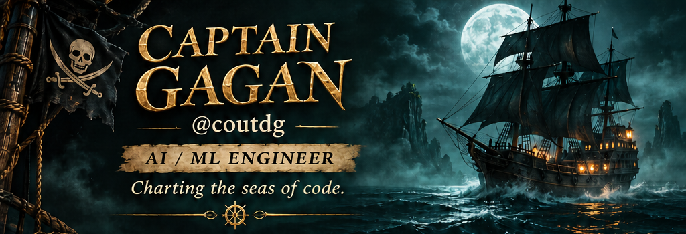

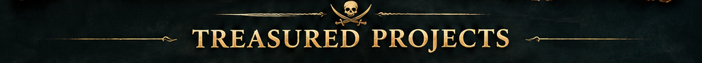

<table>
<tr>
<td width="50%"><a href="https://github.com/coutdg/MLOps-Tutorials">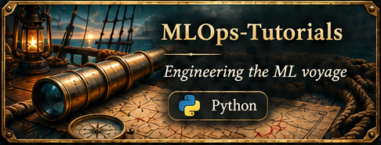</a></td>
<td width="50%"><a href="https://github.com/coutdg/SCRATCH-DL-MODELS">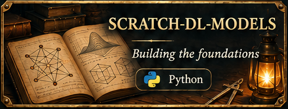</a></td>
</tr>
<tr>
<td width="50%"><a href="https://github.com/coutdg/Deep-learning-Campus-X">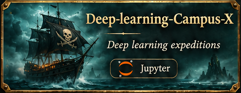</a></td>
<td width="50%"><a href="https://github.com/coutdg/Trees-case-study-">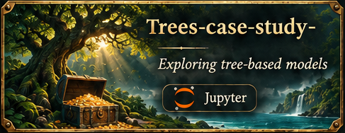</a></td>
</tr>
</table>

### ⚓ The Fleet — Auto-updated Repositories

<!-- REPOS:START -->
<table>
<tr>
<td width="50%"><a href="https://github.com/coutDG/SCRATCH-DL-MODELS">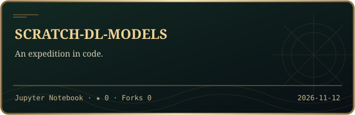</a></td>
<td width="50%"><a href="https://github.com/coutDG/Deep-learning-Campus-X">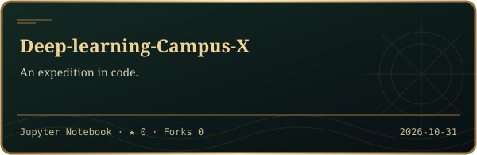</a></td>
</tr>
<tr>
<td width="50%"><a href="https://github.com/coutDG/MLOps-Tutorials">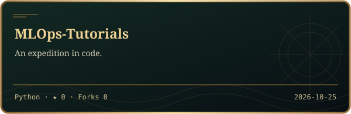</a></td>
<td width="50%"><a href="https://github.com/coutDG/ML-models-from-scratch-">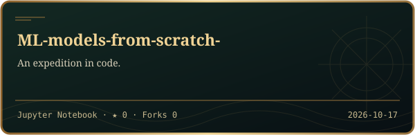</a></td>
</tr>
<tr>
<td width="50%"><a href="https://github.com/coutDG/Trees-case-study-">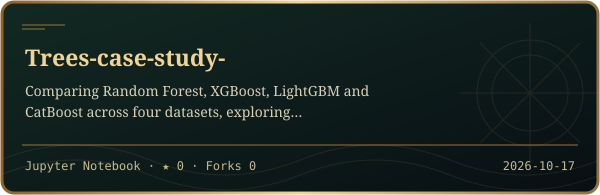</a></td>
<td width="50%"><a href="https://github.com/coutDG/Machine-learning-CampusX">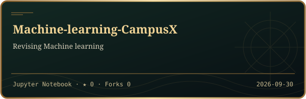</a></td>
</tr>
<tr>
<td width="50%"><a href="https://github.com/coutDG/Data-Science-Projects">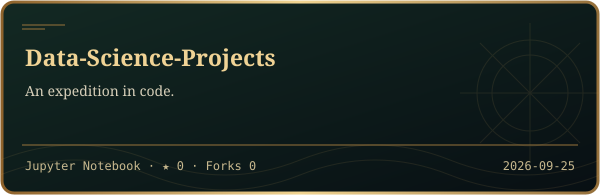</a></td>
<td width="50%"><a href="https://github.com/coutDG/Fine-Tuning-Pegasus">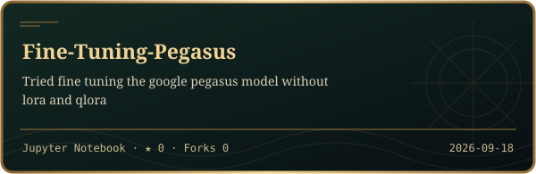</a></td>
</tr>
</table>

🧭 Open the full repository manifest

- [SCRATCH-DL-MODELS](https://github.com/coutDG/SCRATCH-DL-MODELS)
- [Deep-learning-Campus-X](https://github.com/coutDG/Deep-learning-Campus-X)
- [MLOps-Tutorials](https://github.com/coutDG/MLOps-Tutorials)
- [ML-models-from-scratch-](https://github.com/coutDG/ML-models-from-scratch-)
- [Trees-case-study-](https://github.com/coutDG/Trees-case-study-)
- [Machine-learning-CampusX](https://github.com/coutDG/Machine-learning-CampusX)
- [Data-Science-Projects](https://github.com/coutDG/Data-Science-Projects)
- [Fine-Tuning-Pegasus](https://github.com/coutDG/Fine-Tuning-Pegasus)
- [PDF-Manager](https://github.com/coutDG/PDF-Manager)

Public repositories · latest pushes first · refreshed daily by GitHub Actions
<!-- REPOS:END -->

 

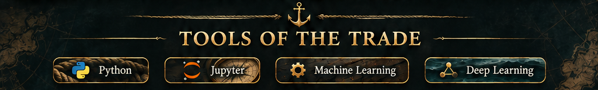

A golden sea serpent sails through the contribution calendar · refreshed daily

  

 

<a href="https://github.com/coutdg?tab=repositories">⚓ Explore the fleet</a> · <a href="https://github.com/coutdg">🧭 Visit the captain</a>

  

